<div align="center">

# 🧬 MemTriage XAI

### Explainable AI triage for Windows memory forensics

Detect malicious Windows memory snapshots with machine learning, **explain every verdict** in plain English,
and **prove the evidence was never altered** — from acquisition to the sealed PDF report.


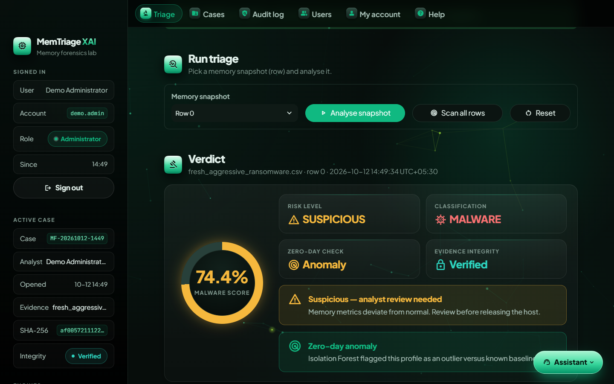

</div>

> **Final-year university project.** A research prototype, not a production forensic tool —
> automated verdicts must always be reviewed by a qualified analyst.

---

## Contents
- [Highlights](#highlights)
- [Screenshots](#screenshots)
- [How it works](#how-it-works)
- [Quick start](#quick-start)
- [Using the dashboard](#using-the-dashboard)
- [Project structure](#project-structure)
- [Evidence integrity & chain of custody](#evidence-integrity--chain-of-custody)
- [Security controls](#security-controls)
- [Models, dataset & results](#models-dataset--results)
- [Command-line tools](#command-line-tools)
- [Testing](#testing)
- [Configuration](#configuration)
- [Known limitations](#known-limitations)
- [Future work](#future-work)
- [Documentation](#documentation)

## Highlights

| | |
|---|---|
| 🧠 **Analysis** | Raw Windows memory dumps (`.raw .mem .vmem .dmp .lime …`) → Volatility 3 extracts 55 features automatically. Also accepts Volatility feature CSVs and built-in sample profiles. |
| 🤖 **Detection** | Random Forest malware score with three risk tiers, plus an Isolation Forest **zero-day** anomaly check. *Scan all rows* scores every snapshot at once. |
| 🔍 **Explainability** | **SHAP** global drivers and **LIME** local rules as interactive charts and plain-English driver cards — *why* the model decided. |
| 🔗 **Chain of custody** | SHA-256 + MD5 at every stage, an **HMAC-keyed custody ledger**, write-protected working copies, and verification of the hash reported by the acquisition tool. Analysis is **blocked** on any mismatch. |
| 🧾 **Provenance** | Where the evidence came from (device, custodian, location, collector, time, tool) and who it is prepared for (recipient, purpose, reference) — sealed into the ledger and the report. |
| 📄 **Sealed reports** | PDF dossier with verdict, explanations, provenance, response actions and the full custody ledger; its SHA-256 is recorded in the ledger, the audit log and a `.sha256` sidecar. |
| 🔐 **Accounts & audit** | Sign-in with roles (Administrator / Analyst), lockout, idle timeout and an **HMAC-chained, tamper-evident audit log** with an Audit log page for administrators. |
| 🧭 **Usability** | Guided start, Cases page to reopen past work, Help page with glossary & FAQ, and an **offline help assistant** that explains your result. Emerald theme with an interactive background. |

## Screenshots

| Sign in | Getting started |
|:---:|:---:|
| 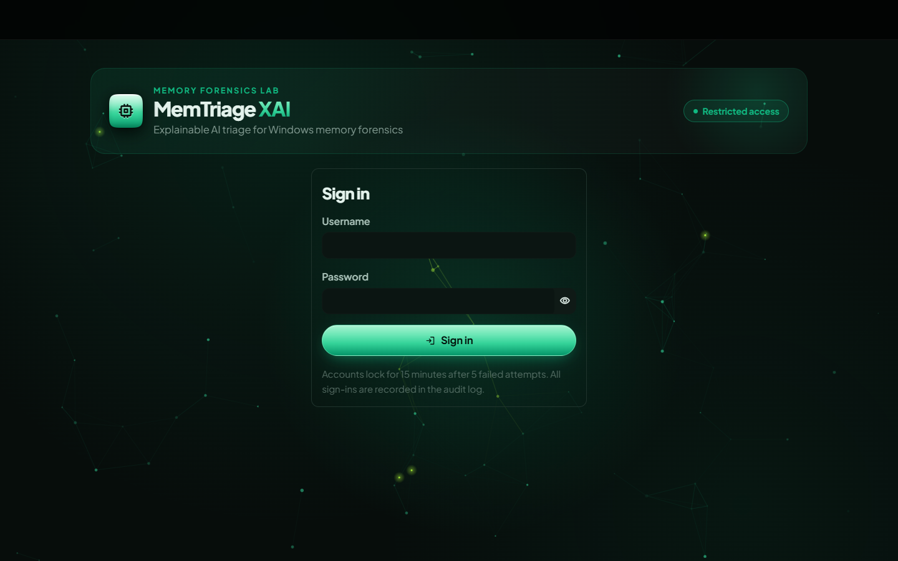 | 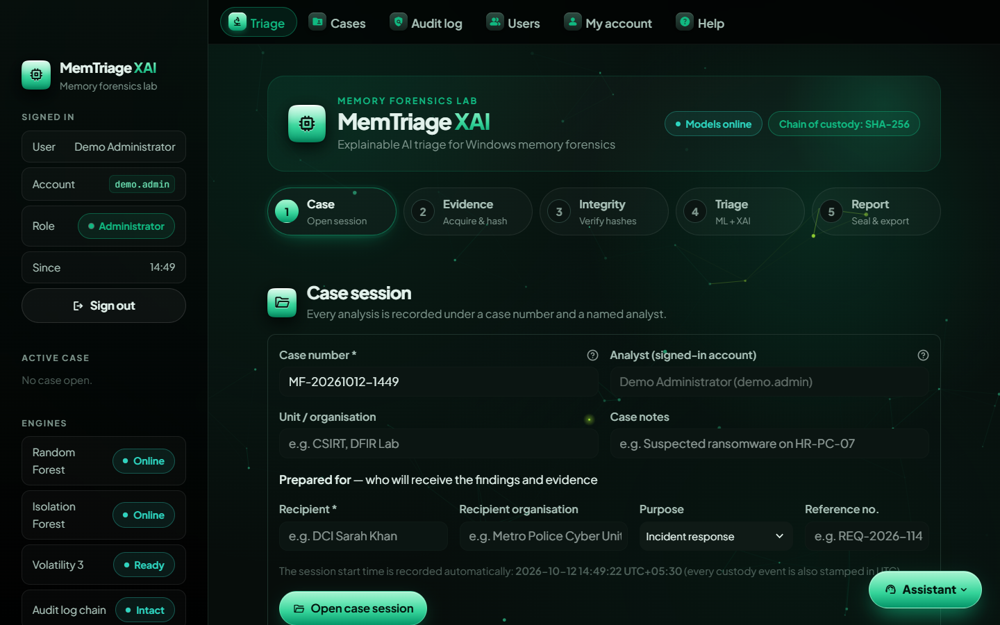 |
| **Explainability (SHAP)** | **Provenance** |
| 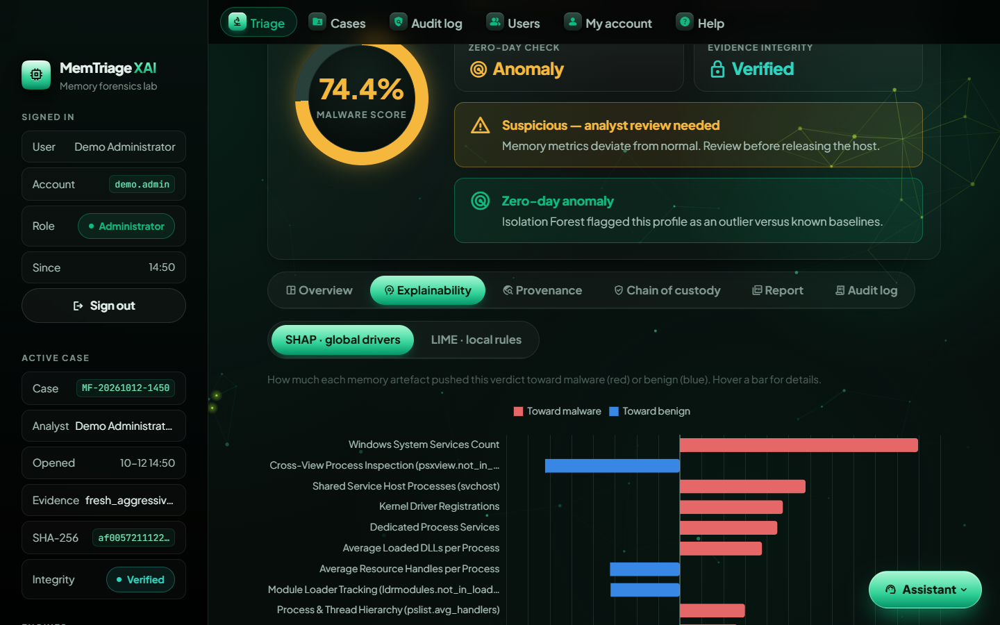 | 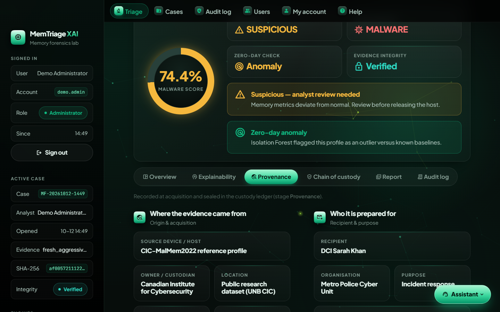 |
| **Cases** | **Audit log (administrators)** |
| 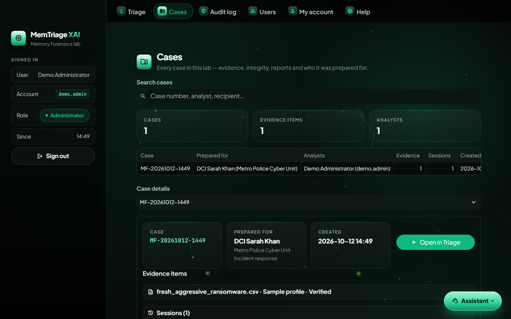 | 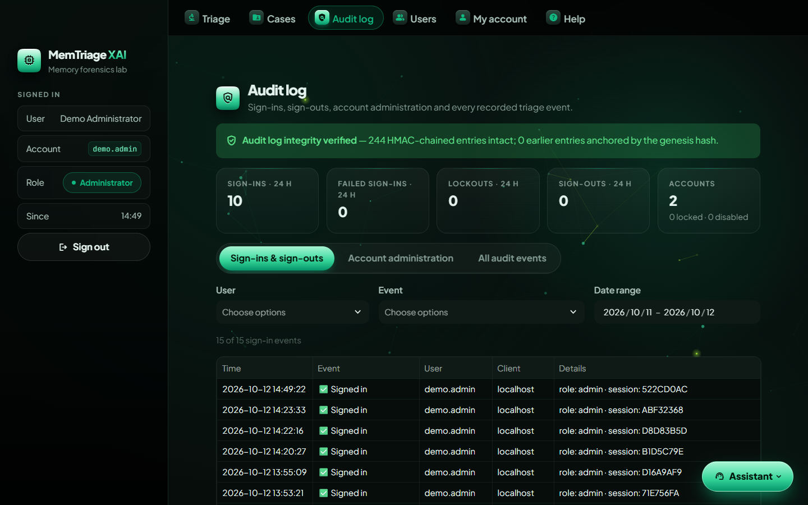 |
| **Offline help assistant** | |
| 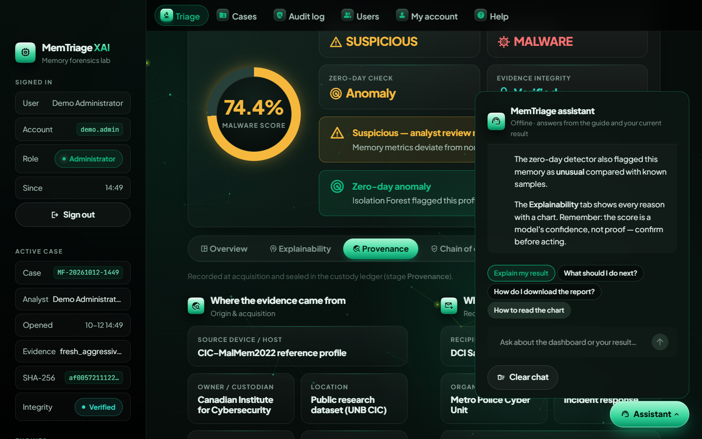 | |

## How it works

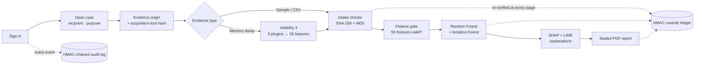

1. **Sign in** — every action is attributed to an authenticated account.
2. **Open a case** — case number plus who the findings are prepared for.
3. **Record the origin** — where the evidence came from; optionally the hash printed by the acquisition tool.
4. **Load evidence** — fingerprinted on arrival (SHA-256 + MD5); uploads become write-protected working copies. Dumps are converted to 55 features with Volatility 3, hashed before and after.
5. **Analyse** — hashes are re-verified, the 55 features are validated, then the models score the snapshot and SHAP/LIME explain it.
6. **Report** — everything is re-verified once more, the PDF is generated and its hash recorded (sealed).

If any re-computed hash differs from the acquisition hash, analysis and report generation are **blocked** and the violation is logged.

## Quick start

**Requirements:** Windows 10/11 (Linux/macOS also work for the dashboard), Python 3.11, ~2 GB disk for packages.

```bash
git clone https://github.com/abdullahazwarsec-arch/Memory-Forensic-Triage-AI.git
cd Memory-Forensic-Triage-AI

python -m venv venv
venv\Scripts\activate            # Windows   (Linux/macOS: source venv/bin/activate)
pip install -r requirements.txt
```

Run the dashboard — double-click **`run_app.bat`**, or:

```bash
streamlit run app.py
```

Open <http://localhost:8501>. **On the first start you create the administrator account**; administrators then add analysts on the **Users** page.

> The trained models are included, so the dashboard works immediately with the built-in sample profiles.
> The training dataset (`Obfuscated-MalMem2022.csv`, CIC-MalMem2022) is only needed to re-train — place it in `data/`.
> The first Volatility run on a new Windows version needs internet access to download kernel symbol tables.

## Using the dashboard

| Page | Who | What you do there |
|---|---|---|
| **Triage** | everyone | Open a case → record the evidence origin → load a sample, CSV or memory dump → *Analyse snapshot* → read the verdict, explanations, provenance and custody ledger → download the sealed report |
| **Cases** | everyone | Search all cases, re-verify each evidence item, download sealed reports, *Continue this case* |
| **Audit log** | administrators | Sign-ins & sign-outs, failed attempts, lockouts, account changes and every recorded event — with integrity status, filters and CSV export |
| **Users** | administrators | Create accounts, disable/enable, unlock, change roles, reset passwords |
| **My account** | everyone | Change password, see your own sign-in history |
| **Help** | everyone | Five-step guide, how to read the verdict, glossary and FAQ |

**Risk tiers:** **Normal** < 40 % · **Suspicious** 40–75 % · **High risk** ≥ 75 %. The **Assistant** button (bottom-right) answers
questions offline — try *“explain my result”* or *“what should I do next?”*.

## Project structure

```text
Memory-Forensic-Triage-AI/
├── app.py                         # Streamlit dashboard: triage workflow, models, SHAP/LIME, PDF report, Cases page
├── run_app.bat                    # Double-click launcher (Windows)
├── requirements.txt               # Runtime dependencies
├── requirements-dev.txt           # + pytest and python-docx (tests and documentation)
├── pytest.ini
│
├── memtriage/                     # Supporting package
│   ├── evidence_integrity.py      # Hashing, HMAC custody ledger, manifest verifier, model hash pinning
│   ├── audit_log.py               # HMAC-chained audit log: writer, verifier, parser, archive CLI
│   ├── input_validation.py        # Intake checks (size, CSV, memory-image signatures) + 55-feature gate
│   ├── memdump_extractor.py       # Volatility 3 dump → 55-feature CSV (also a CLI)
│   ├── auth.py                    # Accounts: PBKDF2 passwords, roles, lockout, sealed account store
│   ├── admin_pages.py             # Sign-in, first-run setup, Audit log, Users, My account pages
│   ├── help_page.py               # Help & glossary page
│   ├── assistant.py               # Offline help assistant
│   ├── ui_theme.py                # Emerald theme and UI components
│   └── assets/background.js       # Interactive background (canvas)
│
├── scripts/
│   ├── training/                  # train_model.py, train_multiclass.py
│   ├── evaluation/                # evaluate_model.py, benchmark.py, explain_model.py, lime_example.py, verify_data_integrity.py
│   ├── data/                      # sample-profile generators, zero-day simulator, class-balance check
│   ├── reports/                   # standalone PDF report examples
│   ├── admin/                     # manage_users.py (account recovery), pin_model_hashes.py
│   └── docs/                      # build the Word documents in docs/
│
├── models/                        # Trained models + model_hashes.json (pinned SHA-256)
├── data/                          # Sample profiles and simulated scenarios (dataset CSV not committed)
├── tests/                         # pytest suite (79 tests)
├── docs/                          # Viva guide, commands runbook, figures, screenshots, results
│
├── outputs/                       # Generated locally: cases, extractions, sealed reports   (git-ignored)
├── logs/                          # Audit log and archived logs                             (git-ignored)
└── keys/                          # Ledger HMAC key and account store — never share         (git-ignored)
```

## Evidence integrity & chain of custody

Every artefact is fingerprinted with SHA-256 and MD5 and re-verified at each stage:

| Stage | What is verified |
|---|---|
| Acquisition | Evidence hashed on arrival — the baseline |
| Acquisition verification | Optional hash reported by the acquisition tool compared with the computed hash |
| Provenance | Origin and recipient sealed into the ledger |
| Working copy | Uploads written to a write-protected copy and re-hashed |
| Pre-/post-extraction | Memory dump hashed immediately before and after Volatility |
| Derived data | Feature CSV hashed and linked to the dump's hash |
| Input validation | Feature check result recorded (and any analyst acknowledgement) |
| Pre-analysis / analysis input | Evidence re-hashed; the exact feature vector sent to the model matches the verified file |
| Pre-report / report | Everything re-hashed; the PDF hash recorded (sealed) |

Ledger entries are linked with **HMAC-SHA256** keyed with a secret ledger key (`keys/ledger_hmac.key`, created on first run,
or `FORENSICS_LEDGER_KEY`), so the ledger cannot be edited and re-chained without the key. Records per case:
`outputs/cases/<case>/case.json` and `outputs/cases/<case>/<evidence-id>/custody_manifest.json`.

```bash
python -m memtriage.evidence_integrity verify outputs/cases/<case>/<evidence-id>/custody_manifest.json
certutil -hashfile <report>.pdf SHA256          # Windows   (Linux/macOS: sha256sum <report>.pdf)
```

> Back up `keys/` securely — manifests and logs sealed with a lost key can no longer be verified.

## Security controls

| Control | Protects against |
|---|---|
| **Accounts** — PBKDF2-SHA256 (600k iterations), roles, 5-attempt lockout (15 min), 30-min idle timeout, forced password change, HMAC-sealed account store | Unauthorised use; self-declared analyst names; hand-edited accounts |
| **HMAC-chained audit log** — file-locked writes, genesis anchor, keyed head file, newline escaping; broken logs are archived unchanged, never re-signed | Edited, inserted, deleted, reordered or truncated log lines; forged log lines via crafted input |
| **Intake checks** — size limits, CSV structure, memory-image file signatures, disk-space guard | Renamed archives/executables, binary or unrelated files, disk exhaustion |
| **Feature gate** — infinite/negative values or > 20 % missing features block analysis; smaller gaps need analyst acknowledgement | Inputs crafted to force a "benign" verdict |
| **Model hash pinning** — models are verified against `models/model_hashes.json` before unpickling | Replaced or tampered model files (pickle code execution) |
| **Localhost binding** and HTML escaping of all user input | Network access to evidence; XSS / markup injection |
| **Offline assistant** — no network calls; sees only a result summary | Case data leaving the machine |

## Models, dataset & results

**Dataset — [CIC-MalMem2022](https://www.unb.ca/cic/datasets/malmem-2022.html):** 58,596 memory snapshots described by 55
Volatility-derived features (processes, DLLs, handles, injected code, hidden processes, services, kernel callbacks), benign
plus 15 malware families across ransomware, spyware and trojan categories.

| Model | Accuracy | Precision | Recall | F1 | ROC-AUC | CV F1 (mean ± sd) |
|---|---|---|---|---|---|---|
| **Random Forest** (dashboard) | 0.9999 | 0.9998 | 1.0000 | 0.9999 | 1.0000 | 0.9998 ± 0.0001 |
| Logistic Regression (baseline) | 0.9987 | 0.9985 | 0.9990 | 0.9987 | 0.9999 | 0.9991 ± 0.0001 |

<p align="center">
  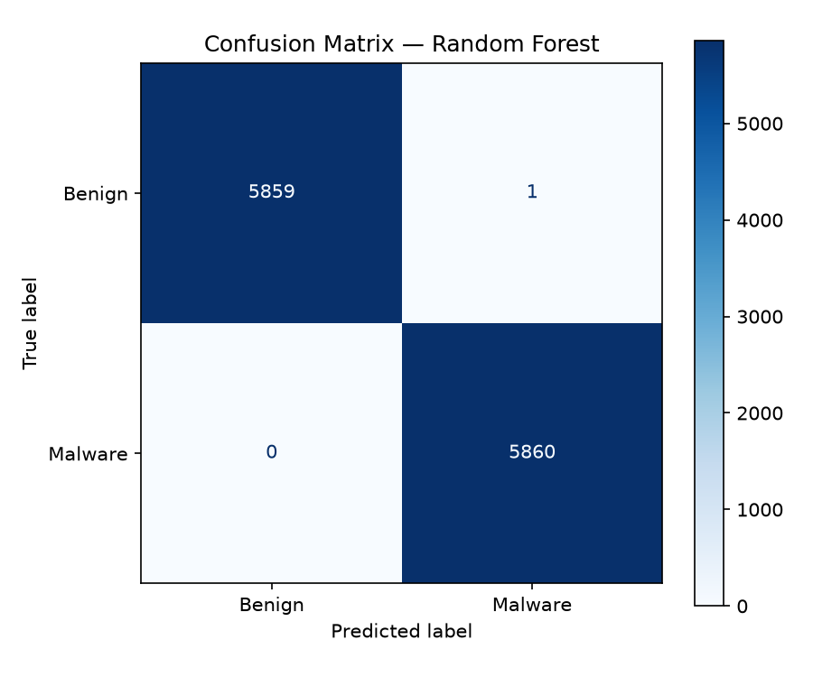
  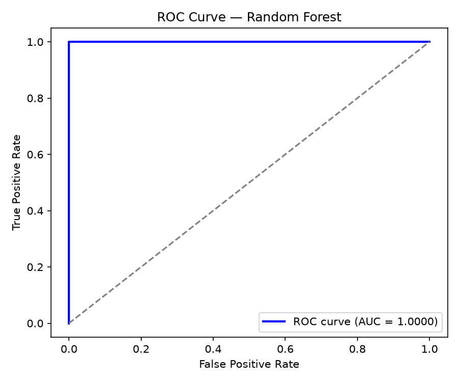
  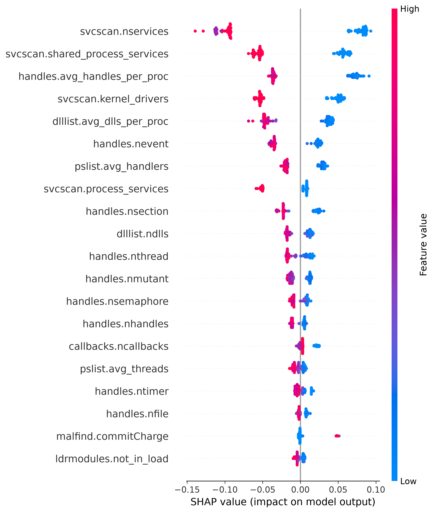
</p>

> ⚠️ These scores are **optimistic** — see [Known limitations](#known-limitations). The **Isolation Forest** zero-day layer
> flags memory unlike anything seen in training.

**Explainability:** SHAP (TreeExplainer) shows how much each feature pushed the verdict towards malware or benign; LIME fits
local rules around the snapshot as an independent check. Both appear as diverging charts (red = towards malware,
blue = towards benign) with plain-English descriptions, and both are included in the PDF report.

**Memory dump extraction:** `memtriage/memdump_extractor.py` runs `windows.info` plus 9 Volatility 3 plugins
(`pslist`, `dlllist`, `handles`, `ldrmodules`, `malfind`, `psxview`, `modules`, `svcscan`, `callbacks`). A few features are
approximations because Volatility 3 lacks some checks used to build the dataset (psxview session/desktop views, de-duplicated
service records, `malfind.protection` as a sum of VAD protection codes). Windows images only.

## Command-line tools

Run from the project root with the virtual environment active.

| Task | Command |
|---|---|
| Memory dump → feature CSV | `python -m memtriage.memdump_extractor "<dump>" [--out <folder>]` |
| Verify the audit log | `python -m memtriage.audit_log verify` |
| Archive a broken audit log | `python -m memtriage.audit_log archive --reason "<why>"` |
| Verify a custody manifest | `python -m memtriage.evidence_integrity verify <custody_manifest.json>` |
| Account recovery | `python scripts/admin/manage_users.py list \| unlock <user> \| reset-password <user> \| create <user> "<Name>" --role admin` |
| Re-pin model hashes (after re-training) | `python scripts/admin/pin_model_hashes.py` |
| Train / evaluate | `python scripts/training/train_model.py` · `python scripts/evaluation/evaluate_model.py` |
| Dataset audit | `python scripts/evaluation/verify_data_integrity.py` |
| Rebuild the Word documents | `python scripts/docs/create_viva_doc.py` · `python scripts/docs/create_commands_runbook_docx.py` |

> `train_model.py` and `evaluate_model.py` overwrite `models/random_forest_model.pkl`. Re-pin the hashes afterwards,
> or the dashboard will (correctly) refuse to load the new model.

## Testing

```bash
pip install -r requirements-dev.txt
python -m pytest
```

**79 tests** (~35 s) covering the custody ledger and forgery detection, model pinning, intake and feature gates, audit-log
tampering, duplicate writers and multi-process writes, archiving, the assistant's topic matching, and end-to-end dashboard
flows (first-run setup, sign-in, lockout, idle timeout, revocation, a sealed triage run). Tests run against a throw-away
key, account store, audit log and output folder — real evidence is never touched.

## Configuration

| Setting | Purpose |
|---|---|
| `.streamlit/config.toml` | Theme, `localhost` binding, upload limit (8 GB) |
| `FORENSICS_LEDGER_KEY` | Ledger HMAC key as 64+ hex characters (instead of `keys/ledger_hmac.key`) |
| `MEMTRIAGE_USERS_FILE` | Alternative account-store location |
| `MEMTRIAGE_AUDIT_LOG` | Alternative audit-log location |
| `MEMTRIAGE_OUTPUT_DIR` | Alternative folder for cases, extractions and reports |

## Known limitations

- **Optimistic accuracy.** Scores come from a random train/test split. Each malware sample has ~10 near-identical snapshots and the dataset has 534 duplicate rows, so near-copies appear in both train and test.
- **Shortcut learning.** Benign snapshots come from essentially one machine configuration (e.g. `svcscan.nservices` only ranges 388–395), so the model largely learns "differs from that benign machine". Benign-labelled profiles can score high, and real dumps from other Windows versions can be misjudged. SHAP/LIME correctly reveal this — they explain the model, not ground truth.
- **Aggregate features only.** The verdict is based on 55 counts; the dashboard cannot yet point to the specific malicious process.
- **Keyed, not signed.** The ledger and audit log use a shared secret: anyone who can read `keys/` could forge them. There is no asymmetric signature or trusted timestamp, and an old log + head pair could be restored together.
- **Local accounts.** No multi-factor authentication, plain HTTP on `localhost`, and reloading the browser signs you out. Anyone with access to `keys/` can reset accounts.
- **Scope.** Windows memory images only; uploaded dumps are held in memory (use the path option for large dumps); Volatility needs internet on first use.

## Future work

- Re-train with duplicates removed, a split grouped by sample, and benign dumps from many machines and Windows versions; calibrate probabilities and warn on out-of-distribution input.
- Show per-process findings (injected regions, hidden processes, PIDs) from the saved Volatility output alongside the verdict.
- Integrate the trained multi-class family model (ransomware / spyware / trojan).
- Digitally sign reports and manifests with trusted (RFC 3161) timestamps.
- MFA/SSO and HTTPS for multi-user deployments; encrypted evidence storage and retention policies.
- Case export/import and machine-readable (JSON/STIX) findings.

## Documentation

| Document | Contents |
|---|---|
| [`docs/Memory_Forensics_Commands_And_Execution_Runbook.docx`](docs/Memory_Forensics_Commands_And_Execution_Runbook.docx) | Every command explained: setup, dashboard, dumps, integrity, scripts, accounts, tests, Git, troubleshooting |
| [`docs/Memory_Forensics_AI_Triage_Viva_Defense_Guide.docx`](docs/Memory_Forensics_AI_Triage_Viva_Defense_Guide.docx) | Architecture, data pipeline, models, XAI, viva questions and a live-demo script |
| [`docs/images/`](docs/images) | Evaluation figures, diagrams and screenshots |
| [`docs/results/model_comparison.csv`](docs/results/model_comparison.csv) | Model comparison metrics |

---

<sub>Built as a final-year project in digital forensics and explainable AI. Dataset: CIC-MalMem2022, Canadian Institute
for Cybersecurity, University of New Brunswick.</sub>
